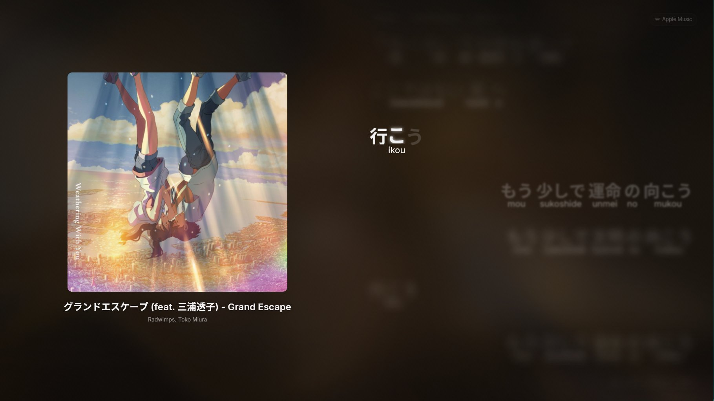
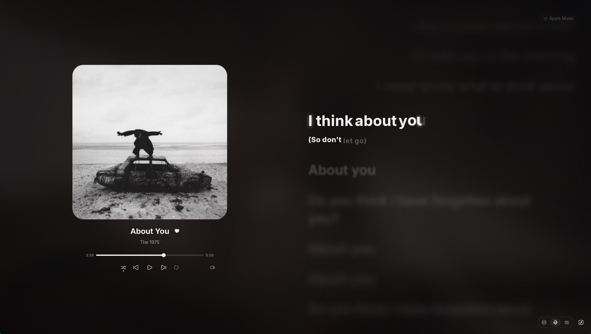
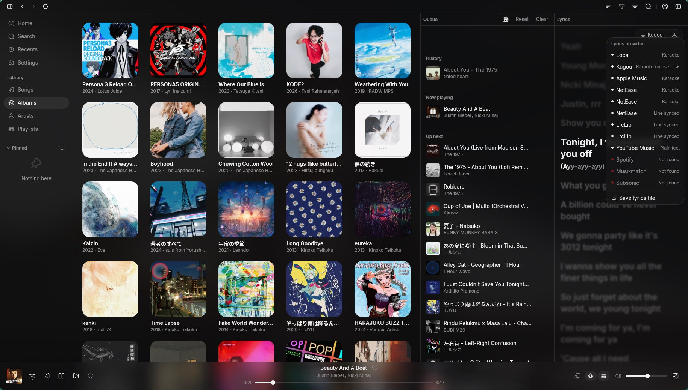
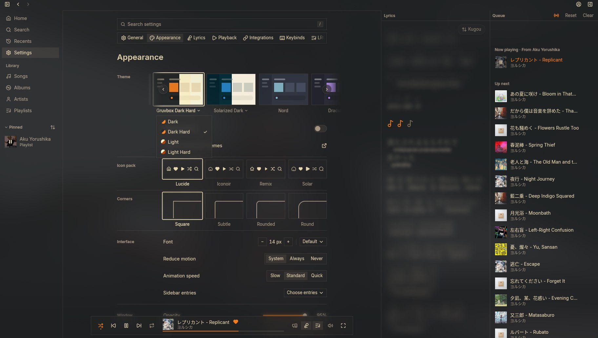
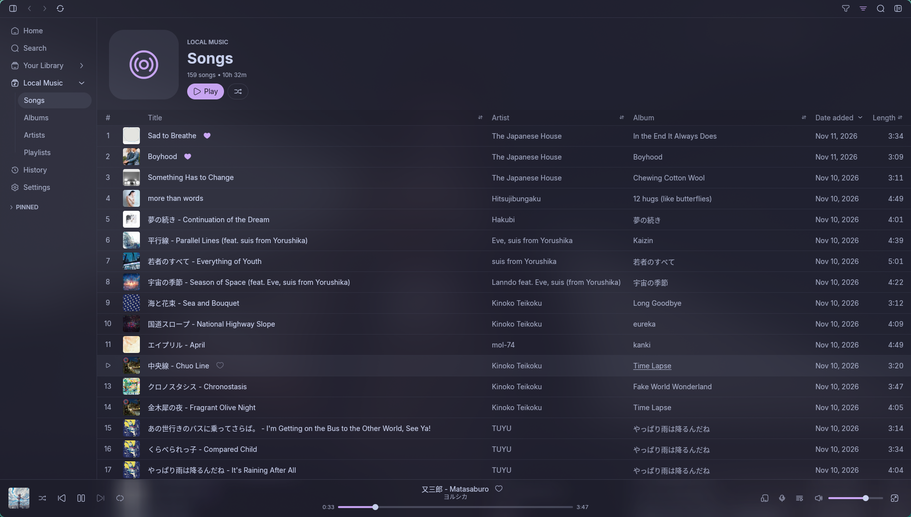
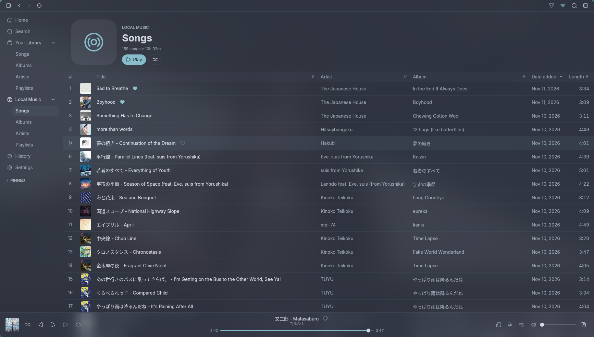
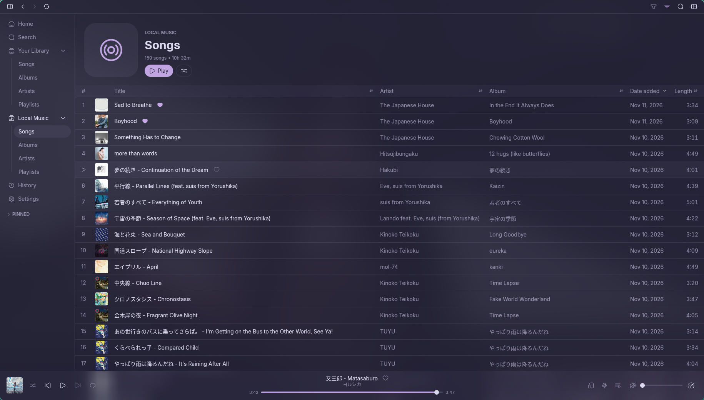

<div align="center">


<h1>Oto</h1>

<p align="center">
  A fast, native music streaming client and local player built with Rust and GPUI.
</p>

[](./COPYING)
[](https://www.rust-lang.org/)
[](https://github.com/zed-industries/zed)

</div>

<div align="center">
  <table>
    <tr>
      <td width="50%">
        <p align="center"><b>Fullscreen Furigana & Ruby Karaoke Sweep</b></p>
        
      </td>
      <td width="50%">
        <p align="center"><b>Fullscreen Karaoke, Backing Vocals & Motion Bloom</b></p>
        
      </td>
    </tr>
    <tr>
      <td width="50%">
        <p align="center"><b>Playlists Grid, Island Bar & Dual Preview (Lyrics + Queue)</b></p>
        
      </td>
      <td width="50%">
        <p align="center"><b>Settings, Appearance & Island Bar (Gruvbox Dark Hard)</b></p>
        
      </td>
    </tr>
  </table>

  <details>
    <summary><b>🎨 Theme Variants Showcase (Click to expand)</b></summary>
    <br/>
    <table>
      <tr>
        <td width="50%">
          <p align="center"><b>Catppuccin Mocha</b></p>
          
        </td>
        <td width="50%">
          <p align="center"><b>Nord</b></p>
          
        </td>
      </tr>
      <tr>
        <td width="50%">
          <p align="center"><b>Rosé Pine Moon</b></p>
          
        </td>
        <td width="50%">
          <p align="center"><b>Gruvbox Dark</b></p>
          
        </td>
      </tr>
    </table>
  </details>
</div>

> [!NOTE]
> **Oto** is an independent fork of [Sonora](https://github.com/sonorahq/sonora) with custom features and fixes built on top of Sonora's engine:
> - **Automix Crossfade & Volume Boost**: Smooth track crossfading with dynamic DJ bass dip, leading silence trimming, `1.35×` max volume gain headroom, and higher default playback volume.
> - **Dual Preview Panel (Queue & Lyrics)**: Side-by-side simultaneous Queue and live Lyrics panels in the right sidebar with dynamic ordering and responsive layout.
> - **Oto Lyrics Motion Presets & Native VSync**: 4 selectable animation presets (`Motion`, `Legacy wave`, `Boring`, `Plain`) synchronized to native display VSync, with continuous wave physics, held-note spring bloom, duet voice alignment (`{agent:v1}`/`{agent:v2}`/`{agent:both}`), and a live singing preview in Settings.
> - **Furigana Karaoke, Dual-Line LRC & Smart Lookups**: Word-by-word ruby/furigana karaoke sweep, dual-line `.lrc` merging, and compound-title / multi-artist fallback across lyrics providers.
> - **Live Lyrics Switcher, Export & LRC Studio**: In-panel source switcher, one-click sidecar save/overwrite (`Standard .lrc`, `Enhanced .lrc`, `Native .krc` with backing vocal & duet tag preservation and automatic stale sidecar cleanup), local `.lrc`/path overview on Song Details, and a built-in **LRC Studio** synced lyrics editor.
> - **Universal Playlist Importer & Subsonic Radio**: Import public playlists (Spotify, YouTube Music, Apple Music, Deezer) into hybrid local/streaming playlists, plus a dedicated **Radio** view for Subsonic/Navidrome internet radio stations.
> - **Desktop Integration & Discord RPC**: Global `Ctrl + Scroll` volume wheel capture, `Ctrl + Q` quit binding, Linux StatusNotifierItem (SNI) tray support, and provider CDN badges + iTunes/Deezer artwork fallback for Discord Rich Presence.

---

## Features

- **Streaming, Local & Radio**: Apple Music, Spotify, YouTube Music, Deezer, Tidal, Plex, Subsonic/Navidrome (including internet radio), offline local files, and `soloistd` headless playback.
- **Native GPUI Interface**: GPU-accelerated UI with floating island or classic player bars, adaptive theming, blur/vibrancy, and customizable icon packs & keybinds.
- **Audio & Scrobbling**: Automix crossfade, gapless playback, loudness normalization, parametric equalizer, and built-in scrobbling (Last.fm, Libre.fm, ListenBrainz, Maloja, teal.fm).

---

## Keyboard Shortcuts

| Shortcut | Action |
| :--- | :--- |
| <kbd>Space</kbd> | Play / Pause |
| <kbd>l</kbd> | Toggle Lyrics panel |
| <kbd>Ctrl</kbd> + <kbd>l</kbd> | Toggle Repeat / Loop |
| <kbd>q</kbd> | Toggle Queue panel |
| <kbd>f</kbd> | Toggle Fullscreen Lyrics & Karaoke view |
| <kbd>Shift</kbd> + <kbd>→</kbd> / <kbd>←</kbd> | Seek forward / backward by 5 seconds |
| <kbd>Ctrl</kbd> + <kbd>→</kbd> / <kbd>←</kbd> | Next / Previous track |
| <kbd>Ctrl</kbd> + <kbd>↑</kbd> / <kbd>↓</kbd> | Volume Up / Down (works anywhere) |
| <kbd>Ctrl</kbd> + <kbd>Scroll</kbd> | Adjust Volume with mouse wheel |
| <kbd>Ctrl</kbd> + <kbd>m</kbd> | Toggle Mute / Unmute |
| <kbd>Ctrl</kbd> + <kbd>s</kbd> / <kbd>Ctrl</kbd> + <kbd>,</kbd> | Open Settings |
| <kbd>Ctrl</kbd> + <kbd>k</kbd> | Focus Search bar |
| <kbd>Ctrl</kbd> + <kbd>q</kbd> | Quit application completely |
| <kbd>Escape</kbd> | Exit Fullscreen / Close modal dialog |

---

## CLI Control

Oto can be controlled directly from scripts, keybinds, or terminal:

```sh
# Playback
oto play "/path/to/song.flac"   # Play file immediately
oto toggle                     # Play / Pause toggle
oto next                       # Skip to next track
oto prev                       # Previous track
oto seek 1:30                  # Jump to timestamp (or +10 / -10)
oto volume 75                  # Set volume percentage

# Status inspection
oto current                    # Output current track & state as JSON
oto watch                      # Stream playback state changes live
```

---

## Installation

Prebuilt binaries and packages are available on the [Releases](https://github.com/BranProHengker/oto/releases/latest) page.

### Linux

#### Flatpak

Download the `.flatpak` bundle from [Releases](https://github.com/BranProHengker/oto/releases/latest) and install it:

```sh
flatpak install --user oto-*.flatpak
```

#### AppImage

Download the `.AppImage` from [Releases](https://github.com/BranProHengker/oto/releases/latest), make it executable, and run it:

```sh
chmod +x oto-*.AppImage
./oto-*.AppImage
```

#### Debian / Ubuntu (.deb)

Download the `.deb` package from [Releases](https://github.com/BranProHengker/oto/releases/latest) and install it:

```sh
sudo dpkg -i oto_*_amd64.deb
```

#### Standalone Binary

Download the prebuilt executable (`oto-*-unknown-linux-gnu`) from [Releases](https://github.com/BranProHengker/oto/releases/latest) and place it into your path:

```sh
chmod +x oto-*-unknown-linux-gnu
mv oto-*-unknown-linux-gnu ~/.local/bin/oto
```

### Windows

#### Installer

Download and run [Oto-Setup.exe](https://github.com/BranProHengker/oto/releases/latest/download/Oto-Setup.exe) (x64) or [Oto-Setup-arm64.exe](https://github.com/BranProHengker/oto/releases/latest/download/Oto-Setup-arm64.exe) (ARM64) from the [latest release](https://github.com/BranProHengker/oto/releases/latest).

#### Portable

Download the `windows-msvc.exe` binary for your architecture from [Releases](https://github.com/BranProHengker/oto/releases/latest) and run it directly without installing.

### macOS

Download the disk image (`.dmg`) from [Releases](https://github.com/BranProHengker/oto/releases/latest), open it, and drag **Oto** to your **Applications** folder.

If macOS blocks the app on first launch:

```sh
xattr -dr com.apple.quarantine /Applications/Oto.app
```

---

## Building from Source

### Prerequisites

- **Rust toolchain** (nightly/stable with Edition 2024 support)
- **C/C++ compiler** (for Widevine CDM parsing & system bindings)
- **Mold linker** (recommended on Linux for ultra-fast link times)
- Sound server headers (`pipewire-alsa` or `pulseaudio-alsa`)

### Build & Run

```sh
# Clone this repository
git clone https://github.com/BranProHengker/oto.git
cd oto

# Run directly
cargo run --locked --package sonora --bin oto

# Build optimized release binary
cargo build --release --locked --package sonora --bin oto
```

The resulting binary will be at `target/release/oto` (or `target/debug/oto`).

---

## Credits & Upstream

Oto builds upon incredible open-source foundations:

- [Sonora](https://github.com/sonorahq/sonora) — The original native streaming music player.
- [Zed](https://github.com/zed-industries/zed) — Creators of [GPUI](https://github.com/zed-industries/zed/tree/main/crates/gpui), the blazing fast GPU rendering framework.
- [librespot](https://github.com/librespot-org/librespot) — Spotify playback & metadata integration.
- [ytmusic-rs](https://github.com/sonorahq/ytmusic-rs) — YouTube Music API implementation.

---

## License

Oto is free software licensed under the [GNU General Public License version 3 or later](COPYING).
