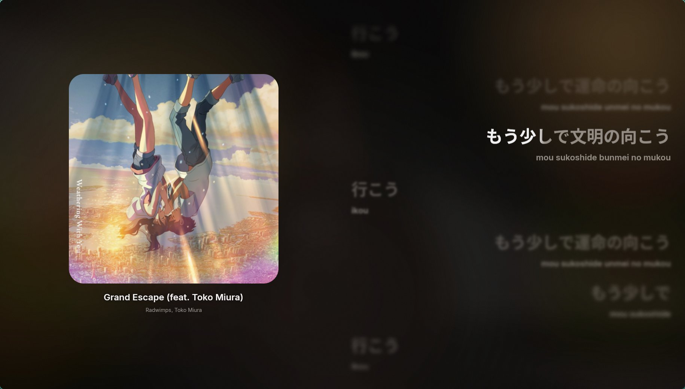
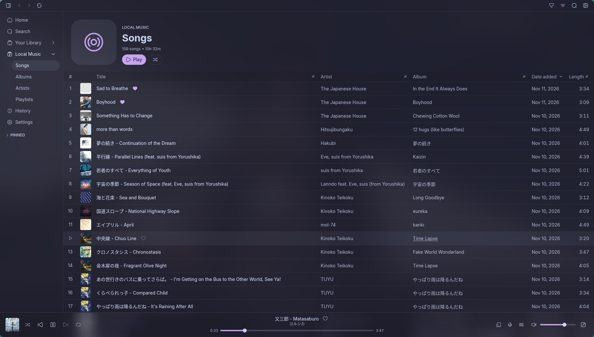
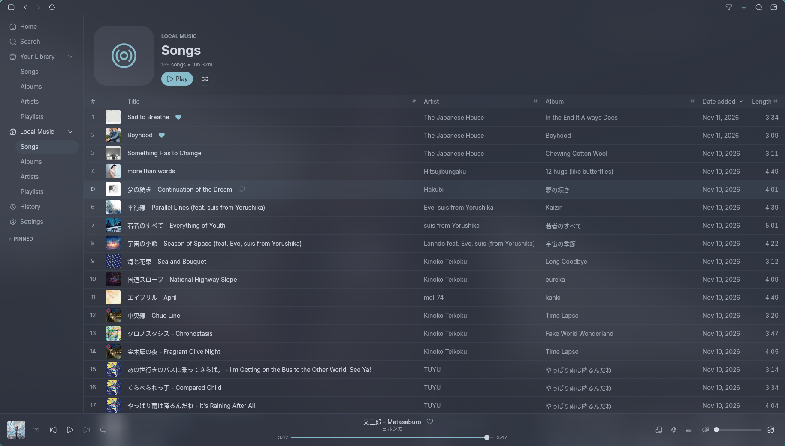
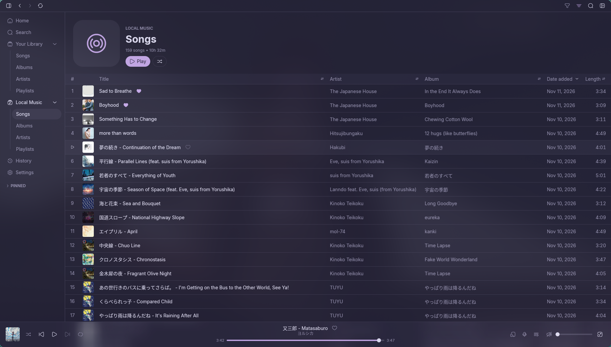
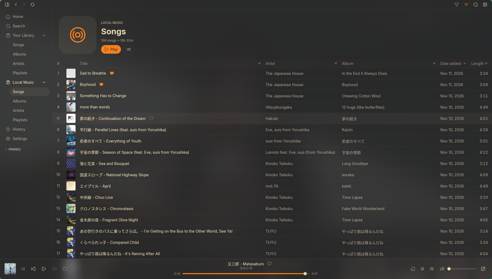

<div align="center">


<h1>Oto</h1>

<p align="center">
  A fast, native music streaming client and local player built with Rust and GPUI.
</p>

[](./COPYING)
[](https://www.rust-lang.org/)
[](https://github.com/zed-industries/zed)

</div>

<div align="center">
  <table>
    <tr>
      <td colspan="2">
        
      </td>
    </tr>
    <tr>
      <td width="50%">
        
      </td>
      <td width="50%">
        
      </td>
    </tr>
    <tr>
      <td width="50%">
        
      </td>
      <td width="50%">
        
      </td>
    </tr>
  </table>
</div>

> [!NOTE]
> **Oto** is an independent fork of [Sonora](https://github.com/sonorahq/sonora). It retains full compatibility with Sonora's native playback engine while adding tailored improvements:
> - **Universal Playlist Importer**: Import public playlist links (Spotify, YouTube Music, Apple Music, Deezer) into native hybrid playlists, prioritizing local lossless audio files over streaming.
> - **Soloist Headless Daemon Integration**: Native support for pairing with `soloistd`, upstream's headless playback daemon. Offload Spotify and audio decoding to a lightweight background daemon and control playback seamlessly without GUI overhead.
> - **Automix Crossfade**: Smart transition blending with dynamic DJ bass dip (high-pass filter sweep) and leading silence trimming.
> - **KuGou, NetEase & Word-by-Word Furigana Karaoke**: Native out-of-the-box support for KuGou & NetEase karaoke lyrics, word-by-word karaoke sweep sync on furigana (Japanese Kanji + Ruby annotation sublane), smart twin-timestamp `.lrc` pairing, and GPU-optimized silky 60+ FPS fullscreen lyrics.
> - **Lyrics Provider Switcher & Local Precedence**: Live lyrics source switcher (`[ ⇅ Switch ]`) with hit indicators (Karaoke, Line synced, In use) and strict local synced lyrics precedence over scrapers.
> - **Flexible Lyrics Save & Export**: One-click lyrics download directly beside local audio files, with configurable export formats in Settings (Standard `.lrc`, Enhanced Karaoke `.lrc` with word timestamps, or Provider Native decoded `.krc`).
> - **Sonora Sessions & Social Listening**: Listen together in sync across any streaming service using lightweight 6-digit room codes and member queue control.
> - **Built-in LRC Studio**: Integrated synced lyrics editor with auto-import from active playback, real-time timestamp tagging, and direct local saving.
> - **Unlimited Audio Cache**: Option to set disk cache to Unlimited (`∞`), preventing premature cache invalidation for large libraries.
> - **Clean UI & Settings**: Streamlined interface without upstream updater clutter or redundant links.
> - **Linux Tray & Desktop Integration**: Native StatusNotifierItem (SNI) tray support optimized for Hyprland, Caelestia shell, and Waybar.
> - **Custom Discord Rich Presence**: Real-time status reporting with direct asset fallbacks for local and streaming playback.

---

## Features

- **Streaming, Local & Headless**: Apple Music, Spotify, YouTube Music, Deezer, Tidal, Subsonic/Navidrome, offline local files, and pairing with headless `soloistd` daemon.
- **Pure Native UI**: Rendered with GPUI (Zed's GPU-accelerated UI framework) — zero Electron, zero WebKit, ultra-low memory usage (~170 MB RSS).
- **Karaoke & Synced Lyrics**: KuGou and NetEase enabled by default, on-the-fly lyrics provider switcher, millisecond-accurate local `.lrc` synchronization, configurable export (Standard/Enhanced/Native KRC), built-in LRC Studio editor, time-synced scrolling lyrics, background vocals, and word-by-word furigana/ruby annotations.
- **Social Listening**: Real-time synchronized playback via Sonora Sessions (cross-service 6-digit room codes) and Spotify Jams with members sidebar.
- **Audio Engine**: Automix crossfade with DJ bass dip, 5-second relative seek shortcuts (`Shift + Arrows`), gapless playback, audio loudness normalization, parametric equalizer, sleep timer, and unlimited cache option.
- **Audio Scrobbler**: Built-in support for LastFM, ListenBrainz, LibreFM, and Maloja.
- **Extensive Theming**: Dynamic adaptive palettes, blur/vibrancy, font adjustments, and interchangeable icon packs.

---

## Keyboard Shortcuts

| Shortcut | Action |
| :--- | :--- |
| <kbd>Space</kbd> | Play / Pause |
| <kbd>f</kbd> | Toggle Fullscreen Lyrics & Karaoke view |
| <kbd>Shift</kbd> + <kbd>→</kbd> / <kbd>←</kbd> | Seek forward / backward by 5 seconds |
| <kbd>Ctrl</kbd> + <kbd>→</kbd> / <kbd>←</kbd> | Next / Previous track |
| <kbd>Ctrl</kbd> + <kbd>↑</kbd> / <kbd>↓</kbd> | Volume Up / Down |
| <kbd>Ctrl</kbd> + <kbd>,</kbd> | Open Settings |
| <kbd>Ctrl</kbd> + <kbd>k</kbd> | Focus Search bar |
| <kbd>Escape</kbd> | Exit Fullscreen / Close modal dialog |

---

## CLI Control

Oto can be controlled directly from scripts, keybinds, or terminal:

```sh
# Playback
oto play "/path/to/song.flac"   # Play file immediately
oto toggle                     # Play / Pause toggle
oto next                       # Skip to next track
oto prev                       # Previous track
oto seek 1:30                  # Jump to timestamp (or +10 / -10)
oto volume 75                  # Set volume percentage

# Status inspection
oto current                    # Output current track & state as JSON
oto watch                      # Stream playback state changes live
```

---

## Installation

Prebuilt binaries and packages are available on the [Releases](https://github.com/BranProHengker/oto/releases/latest) page.

### Linux

#### Flatpak

Download the `.flatpak` bundle from [Releases](https://github.com/BranProHengker/oto/releases/latest) and install it:

```sh
flatpak install --user oto-*.flatpak
```

#### AppImage

Download the `.AppImage` from [Releases](https://github.com/BranProHengker/oto/releases/latest), make it executable, and run it:

```sh
chmod +x oto-*.AppImage
./oto-*.AppImage
```

#### Debian / Ubuntu (.deb)

Download the `.deb` package from [Releases](https://github.com/BranProHengker/oto/releases/latest) and install it:

```sh
sudo dpkg -i oto_*_amd64.deb
```

#### Standalone Binary

Download the prebuilt executable (`oto-*-unknown-linux-gnu`) from [Releases](https://github.com/BranProHengker/oto/releases/latest) and place it into your path:

```sh
chmod +x oto-*-unknown-linux-gnu
mv oto-*-unknown-linux-gnu ~/.local/bin/oto
```

### Windows

#### Installer

Download and run [Oto-Setup.exe](https://github.com/BranProHengker/oto/releases/latest/download/Oto-Setup.exe) (x64) or [Oto-Setup-arm64.exe](https://github.com/BranProHengker/oto/releases/latest/download/Oto-Setup-arm64.exe) (ARM64) from the [latest release](https://github.com/BranProHengker/oto/releases/latest).

#### Portable

Download the `windows-msvc.exe` binary for your architecture from [Releases](https://github.com/BranProHengker/oto/releases/latest) and run it directly without installing.

### macOS

Download the disk image (`.dmg`) from [Releases](https://github.com/BranProHengker/oto/releases/latest), open it, and drag **Oto** to your **Applications** folder.

If macOS blocks the app on first launch:

```sh
xattr -dr com.apple.quarantine /Applications/Oto.app
```

---

## Building from Source

### Prerequisites

- **Rust toolchain** (nightly/stable with Edition 2024 support)
- **C/C++ compiler** (for Widevine CDM parsing & system bindings)
- **Mold linker** (recommended on Linux for ultra-fast link times)
- Sound server headers (`pipewire-alsa` or `pulseaudio-alsa`)

### Build & Run

```sh
# Clone this repository
git clone https://github.com/BranProHengker/oto.git
cd oto

# Run directly
cargo run --locked --package sonora --bin oto

# Build optimized release binary
cargo build --release --locked --package sonora --bin oto
```

The resulting binary will be at `target/release/oto` (or `target/debug/oto`).

---

## Credits & Upstream

Oto builds upon incredible open-source foundations:

- [Sonora](https://github.com/sonorahq/sonora) — The original native streaming music player.
- [Zed](https://github.com/zed-industries/zed) — Creators of [GPUI](https://github.com/zed-industries/zed/tree/main/crates/gpui), the blazing fast GPU rendering framework.
- [librespot](https://github.com/librespot-org/librespot) — Spotify playback & metadata integration.
- [ytmusic-rs](https://github.com/sonorahq/ytmusic-rs) — YouTube Music API implementation.

---

## License

Oto is free software licensed under the [GNU General Public License version 3 or later](COPYING).
