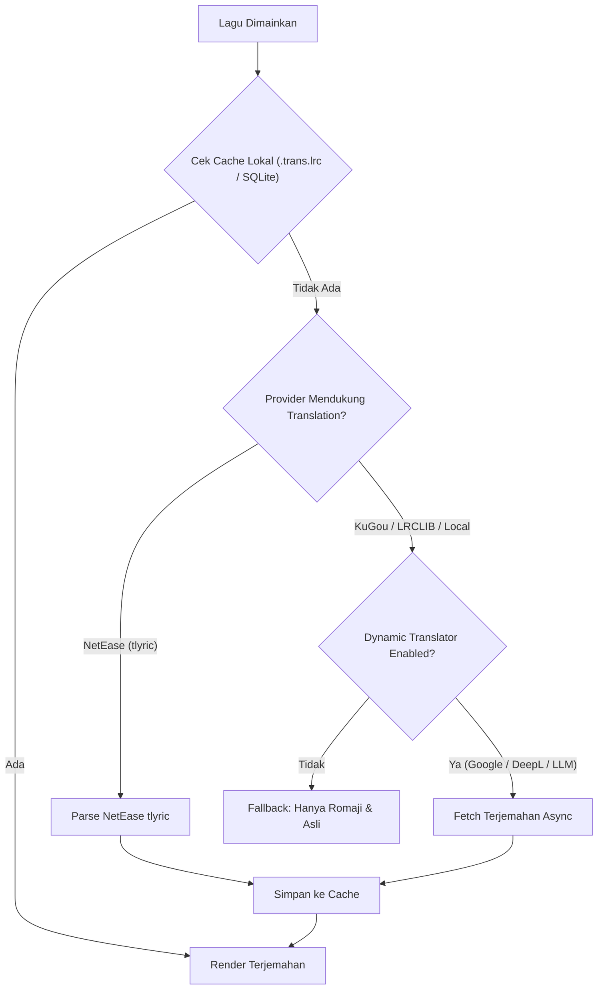

# Design Proposal: Fitur Terjemahan Lirik (Lyrics Translation) di Oto

Dokumen perencanaan dan desain arsitektur untuk penambahan fitur **Lyrics Translation** (Terjemahan Lirik Bahasa Indonesia/Inggris) di Oto.

---

## 1. Goal Description

Saat ini Oto sudah mendukung:
1. **Lirik Asli (Spoken/Sung)** dengan sinkronisasi suku kata / kata-per-kata (karaoke sweep).
2. **Furigana / Ruby Annotations** di atas kanji Jepang.
3. **Romanisasi Otomatis** (Romaji, Pinyin, Hangul romanization, Cyrillic, dll.) sebagai baris sekunder (*romanized lane*).

**Tujuan Fitur Terjemahan Lirik**:
Menghadirkan terjemahan makna lagu (terutama lagu Jepang/Korea/Mandarin/Barat ke Bahasa Indonesia atau Inggris) secara sinkron dengan musik yang sedang berjalan, baik di panel samping (*Aside*) maupun mode *Fullscreen*.

---

## 2. Visual & UI/UX Breakdown

### A. Anatomi Baris Lirik (3-Tier Typography Hierarchy)

Dengan adanya translasi, satu bait baris lirik memiliki hirarki visual berbobot yang proporsional agar tidak berantakan:

```text
┌─────────────────────────────────────────────────────────────┐
│ [Ruby/Furigana]        きみ           あい                  │  <- Ruby tokens (opsional, di atas kanji)
│ [Baris Utama]        君のこと  愛してる                     │  <- Teks asli (Font tebal, glow saat aktif)
│ [Romanisasi]         kimi no koto aishiteru                 │  <- Romaji/Pinyin (Font kecil, warna quiet)
│ [Terjemahan]         Aku sungguh mencintaimu                │  <- Terjemahan (Font sedang, aksen lembut)
└─────────────────────────────────────────────────────────────┘
```

### B. Mockup Tampilan di Panel Samping (*Aside*) & *Fullscreen*

```
─────────────────────────────────────────────────────────────
OTO LYRICS                               [Source: NetEase ▾] [ID ▾] [💾]
─────────────────────────────────────────────────────────────

      [01:14]
      夜に駆ける
      yoru ni kakeru
      Berlari menembus malam

  ▶   沈むように溶けてゆくように
      shizumu you ni tokete yuku you ni
      Seakan tenggelam dan perlahan melebur

      二人だけの空が広がる夜に
      futari dake no sora ga hirogaru yoru ni
      Di malam saat langit hanya membentang untuk kita berdua
─────────────────────────────────────────────────────────────
```

### C. Mode Tampilan (Display Modes)

Pengguna dapat memilih tata letak yang diinginkan di Settings:
1. **Stacked (Default)**: Tampilkan Teks Asli + Romaji (opsional) + Terjemahan di bawahnya.
2. **Subtitle Glow (Minimalis)**: Terjemahan hanya muncul pada baris yang **sedang aktif bernyanyi**, baris lain hanya teks asli/romaji.
3. **Switch Mode**: Tombol cepat di floating pill untuk ganti tampilan antara `Original` ↔ `Romaji` ↔ `Terjemahan`.

---

## 3. Sumber Data Terjemahan (Data Sources & Providers)

Ada 3 opsi pendekatan untuk mendapatkan terjemahan lirik:



### Opsi 1: Provider-Supplied Translation (NetEase `tlyric` & Local Sidecar)
* **Kelebihan**: 
  - 100% gratis, tanpa API key.
  - Zero latency (langsung terbawa saat search lirik NetEase).
  - Terjemahan buatan manusia (*poetic & natural*), bukan terjemahan mesin kaku.
  - NetEase API di `crates/music/src/netease/mod.rs` secara *native* sudah menyediakan field `tlyric` dan `ytv` (lirik terjemahan yang sinkron waktu).
* **Kekurangan**: Terbatas pada lagu yang sudah memiliki kontribusi terjemahan di database NetEase.

### Opsi 2: Local Sidecar (`<lagu>.trans.lrc` atau Dual-Timestamp LRC)
* Mendukung file lirik lokal dengan format ganda:
  ```lrc
  [01:23.45] 沈むように溶けてゆくように
  [01:23.45] Seakan tenggelam dan perlahan melebur
  ```
  atau sidecar berdampingan: `lagu.mp3`, `lagu.lrc`, `lagu.id.lrc` / `lagu.trans.lrc`.

### Opsi 3: Dynamic On-the-fly Translation (Google Translate / DeepL / LibreTranslate)
* **Kelebihan**: Bisa menerjemahkan lagu apa pun secara instan ke bahasa apa pun (termasuk Bahasa Indonesia).
* **Kekurangan**: Terjemahan mesin terkadang kaku, butuh akses internet/API endpoint.
* **Solusi**: Dijalankan secara *background async* di `state`, lalu di-*cache* permanen ke `cache.sqlite` agar sebuah lagu hanya diterjemahkan satu kali.

> [!TIP]
> **Rekomendasi Arsitektur (Hybrid)**:
> 1. Prioritas 1: Baca dari sidecar lokal (`.id.lrc` / `.trans.lrc`) atau dual-timestamp.
> 2. Prioritas 2: Ambil official `tlyric` jika sumber lirik adalah NetEase.
> 3. Prioritas 3 (Opsional): Tombol "Terjemahkan dengan AI/Mesin" untuk lagu yang belum punya terjemahan, lalu disimpan ke cache SQLite.

---

## 4. Proposed Code Changes

### Component 1: `crates/music/src/models.rs`
Menambahkan field `translation` pada struct lirik.

#### [MODIFY] `crates/music/src/models.rs`
```rust
pub struct LyricsLine {
    pub start: Duration,
    pub end: Option<Duration>,
    pub text: String,
    pub romanized: Option<RomanizedText>,
+   pub translation: Option<String>,
    pub words: Option<Vec<LyricsWord>>,
    pub secondary: Vec<LyricsLane>,
    pub voice: Voice,
}

pub struct LyricsLane {
    pub start: Duration,
    pub end: Option<Duration>,
    pub text: String,
    pub romanized: Option<RomanizedText>,
+   pub translation: Option<String>,
    pub words: Option<Vec<LyricsWord>>,
}
```

---

### Component 2: `crates/music/src/netease/mod.rs`
Mengekstrak `tlyric` dari payload NetEase dan menggabungkannya ke dalam baris waktu yang cocok.

#### [MODIFY] `crates/music/src/netease/mod.rs`
```rust
struct Sheet {
    lrc: Option<Verse>,
    yrc: Option<Verse>,
+   tlyric: Option<Verse>,
    #[serde(default, rename = "pureMusic")]
    pure_music: bool,
}
```
Parser NetEase akan memetakan baris `tlyric` ke `LyricsLine.translation` berdasarkan kecocokan *timestamp* (`start`).

---

### Component 3: `crates/state/src/settings.rs`
Menyimpan preferensi user untuk terjemahan lirik.

#### [MODIFY] `crates/state/src/settings.rs`
```rust
pub struct SettingsValues {
    ...
    romanized_lyrics: bool,
+   translated_lyrics: bool,
+   translation_language: String, // e.g. "id", "en"
}
```

---

### Component 4: `crates/views/src/chrome/aside.rs`
Menampilkan terjemahan di bawah teks lirik atau di bawah romaji.

#### [MODIFY] `crates/views/src/chrome/aside.rs`
```rust
fn translated_lyrics_lane(text: String, size: Pixels, theme: &ui::Theme) -> Div {
    div()
        .text_size(size)
        .text_color(theme.text_secondary)
        .line_clamp(2)
        .child(SharedString::from(text))
}
```
Dan di dalam rendering bait (`self.verses`):
```rust
.child(primary)
.when(ruby_tokens.is_none(), |this| {
    this.when_some(
        selected_romanization(&line.romanized, romanization_scripts),
        |this, text| this.child(romanized_lyrics_lane(text, lane_size, &theme)),
    )
})
+.when_some(
+    settings.translated_lyrics().then(|| line.translation.clone()).flatten(),
+    |this, trans| this.child(translated_lyrics_lane(trans, lane_size, &theme)),
+)
```

---

## 5. User Review Required & Design Decisions

> [!IMPORTANT]
> **Pertanyaan & Keputusan Desain Penting**:
> 1. **Sumber Terjemahan Utama**:
>    - Apakah ingin mulai dari **Fase 1 (NetEase `tlyric` + File Lokal `.id.lrc`/`.trans.lrc`)** yang sangat bersih, cepat, dan puitis?
>    - Atau ingin langsung integrasi **Mesin Penerjemah Otomatis (Google Translate / DeepL)** agar lagu bahasa Inggris/Jepang apapun otomatis ada arti Indonesianya?
> 2. **Tingkat Kepadatan Teks (Density)**:
>    - Jika ada Teks Asli + Furigana + Romaji + Terjemahan, baris bisa menjadi cukup tinggi (4 tingkat). Apakah lebih suka:
>      - **Opsi A**: Ditumpuk semua sekaligus (berguna untuk yang sedang belajar bahasa).
>      - **Opsi B**: Ada toggle switch cepat di toolbar lirik untuk memilih antara menampilkan `Romaji Saja`, `Terjemahan Saja`, atau `Keduanya`.
> 3. **Bahasa Sasaran**:
>    - Apakah fokus utama adalah **Bahasa Indonesia (ID)** atau mendukung *selector* multi-bahasa (ID / EN)?

---

## 6. Verification Plan

### Automated Tests
- Parser test untuk sinkronisasi dual-LRC (`tlyric` NetEase matching dengan `lrc`/`yrc`).
- Verifikasi toleransi timing perbedaan milidetik antara baris lirik asli dan baris terjemahan.
- `cargo check --workspace` & `cargo test --workspace`.

### Manual Verification
1. Putar lagu Jepang populer di NetEase (misal: *Yoasobi - Yoru ni Kakeru* atau *Kenshi Yonezu - Lemon*).
2. Periksa apakah baris terjemahan muncul rapi di bawah baris lagu.
3. Cek responsivitas tampilan saat mode Fullscreen dan saat ukuran window di-*resize*.
4. Uji toggle on/off di Settings.
